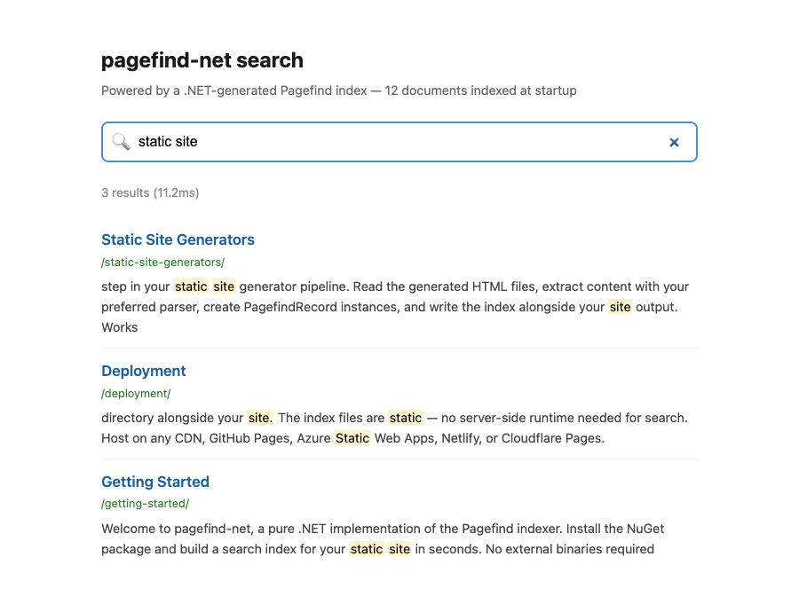

<p align="center">
  <a href="https://pagefind.nullean.net">
    <picture>
      <source media="(prefers-color-scheme: light)" srcset="docs/images/pagefind-net-lockup-light.svg">
      
    </picture>
  </a>
</p>

<p align="center">Generate <a href="https://pagefind.app/">Pagefind</a> search indexes from pure .NET: no native binary, no subprocess, no platform restrictions. The whole indexing pipeline runs in managed code and is AOT-compatible.</p>

<p align="center">
  <a href="https://www.nuget.org/packages/Pagefind.Net"></a>
  <a href="https://github.com/nullean/pagefind-net/actions/workflows/ci.yml"></a>
  <a href="https://pagefind.nullean.net"></a>
</p>



<sub>`examples/Pagefind.Net.Web`, run locally: the index is written by Pagefind.Net at startup, and searched in the
browser by the Pagefind runtime that `Pagefind.Net.Frontend` ships.</sub>

## Install

```sh
dotnet add package Pagefind.Net
dotnet add package Pagefind.Net.Frontend
```

## Quick start

```csharp
using Pagefind.Net;

var index = new PagefindIndex(new PagefindIndexOptions { Language = "en" });

index.AddRecord(new PagefindRecord
{
	Url = "/guide/",
	Title = "Getting started",
	Content = "Install the package, add your pages, write the index.",
	WeightedSegments =
	[
		new WeightedSegment("Getting started", Weight: 7),                                      // h1
		new WeightedSegment("Install the package, add your pages, write the index.", Weight: 1), // body
	],
	Anchors = [new PagefindAnchor(ElementId: "install", Text: "Install", Location: 0, Tag: "h2")],
	Meta = new Dictionary<string, string> { ["title"] = "Getting started" },
});

await index.WriteAsync("wwwroot");   // wwwroot/pagefind/: pagefind-entry.json, *.pf_meta, index/, fragment/
```

`WriteAsync` writes the index data files into `wwwroot/pagefind/`. **Pagefind.Net.Frontend** ships `pagefind.js` and
`wasm.en.pagefind` and extracts them into `wwwroot/pagefind/` on build, through an MSBuild target. No npm install
required. Serve `wwwroot/` and search it with Pagefind's JavaScript API or UI.

Pages you have already parsed into headings and text can go in as `HtmlPageData` with `AddHtmlRecord`, which weights
them as the Pagefind binary does.

Targets Pagefind **1.5.2**. The index format is version-pinned; see `PagefindIndex.PagefindTargetVersion`.

## Packages

| Package | What it is | |
|---|---|---|
| [`Pagefind.Net`](src/Pagefind.Net/README.md) | The indexer: records in, Pagefind index data files out. | [](https://www.nuget.org/packages/Pagefind.Net) |
| [`Pagefind.Net.Frontend`](src/Pagefind.Net.Frontend/README.md) | The Pagefind 1.5.2 browser runtime (`pagefind.js`, `wasm.en.pagefind`), extracted on build. | [](https://www.nuget.org/packages/Pagefind.Net.Frontend) |

## Learn more

- Documentation: https://pagefind.nullean.net
  ([getting started](https://pagefind.nullean.net/getting-started/), [ASP.NET](https://pagefind.nullean.net/getting-started/asp-net/),
  [reference](https://pagefind.nullean.net/reference/))
- [Releases](https://github.com/nullean/pagefind-net/releases)
- [Contributing](https://github.com/nullean/.github/blob/main/CONTRIBUTING.md)

MIT licensed. Copyright Nullean and contributors. Third-party notices in [NOTICE.txt](NOTICE.txt).
