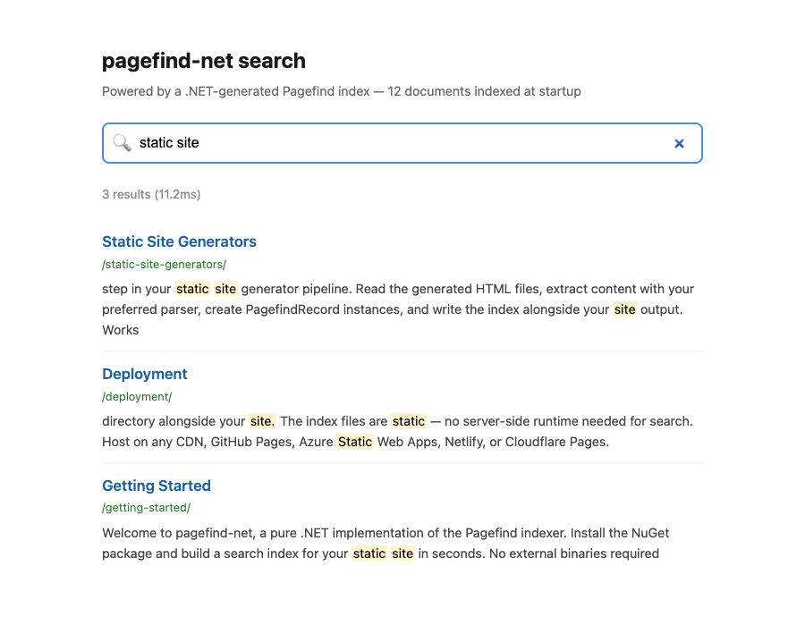

# Pagefind.Net


A pure .NET indexer that generates a [Pagefind](https://pagefind.app/)-compatible search index. No native Rust binary or subprocess: the whole indexing pipeline runs in managed code and is AOT-compatible.

[](https://www.nuget.org/packages/Pagefind.Net)

## Install

```sh
dotnet add package Pagefind.Net
```

## Quick start

```csharp
using Pagefind.Net;

var index = new PagefindIndex(new PagefindIndexOptions { Language = "en" });

index.AddRecord(new PagefindRecord
{
	Url = "/guide/",
	Title = "Getting started",
	Content = "Install the package, add your pages, write the index.",
	WeightedSegments =
	[
		new WeightedSegment("Getting started", Weight: 7),                                      // h1
		new WeightedSegment("Install the package, add your pages, write the index.", Weight: 1), // body
	],
	Anchors = [new PagefindAnchor(ElementId: "install", Text: "Install", Location: 0, Tag: "h2")],
	Meta = new Dictionary<string, string> { ["title"] = "Getting started" },
});

await index.WriteAsync("wwwroot");   // wwwroot/pagefind/: pagefind-entry.json, *.pf_meta, index/, fragment/
```

`WriteAsync` writes all index data files into `wwwroot/pagefind/`:

- `pagefind-entry.json`
- `pagefind.{hash}.pf_meta`
- `index/{hash}.pf_index`
- `fragment/{hash}.pf_fragment`

Pages already parsed into headings and text can go in as `HtmlPageData`, weighted as the Pagefind binary does:

```csharp
using Pagefind.Net;

var index = new PagefindIndex();

// Headings and body text in document order: the heading levels set the weights, as the Pagefind binary does.
index.AddHtmlRecord(new HtmlPageData
{
	Url = "/guide/",
	Sections =
	[
		new HtmlSection("h1", "Getting started"),
		new HtmlSection("p", "Install the package, add your pages, write the index."),
	],
});

await index.WriteAsync("wwwroot");
```



## Key types

| Type | Description |
|------|-------------|
| `PagefindIndex` | Accumulates records and writes the index via `WriteAsync`. |
| `PagefindRecord` | A single searchable document with URL, title, content, segments, anchors, metadata and filters. |
| `HtmlPageData` | A page as headings and text in document order, for `AddHtmlRecord`. |
| `WeightedSegment` | A text segment with a search weight (body = 1, H2 = 4, H1 = 7). |
| `PagefindAnchor` | A heading anchor for sub-page deep links in search results; `Location` is a word offset into `Content`. |
| `PagefindIndexOptions` | Language, extra characters to index, merge batch size and the meta fields to index. |

## Frontend runtime

This package writes only the index **data** files. The Pagefind query runtime (`pagefind.js` and
`wasm.en.pagefind`) comes separately: install [Pagefind.Net.Frontend](https://www.nuget.org/packages/Pagefind.Net.Frontend),
which ships the runtime and extracts it on build, or the [`pagefind`](https://www.npmjs.com/package/pagefind) npm
package and copy the runtime files yourself.

Targets Pagefind 1.5.2 (`PagefindIndex.PagefindTargetVersion`). Reference: https://pagefind.nullean.net/reference/pagefind-index/

## Learn more

- Documentation: https://pagefind.nullean.net
- Source and issues: https://github.com/nullean/pagefind-net
